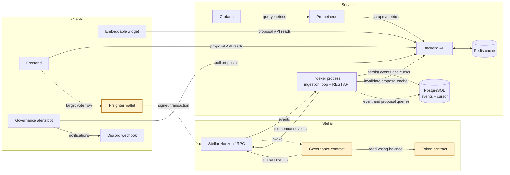

# VoteChain Contracts

[](https://github.com/veracindarella/votechain-contracts/actions/workflows/ci.yml)
[](https://github.com/veracindarella/votechain-contracts/actions/workflows/ci.yml)
[](https://github.com/veracindarella/votechain-contracts/actions/workflows/deploy-staging.yml)
[](https://github.com/veracindarella/votechain-contracts/actions/workflows/stellar-protocol-compat.yml)
[](LICENSE)
[](https://github.com/veracindarella/votechain-contracts/milestone/1)
[](https://github.com/veracindarella/votechain-contracts/milestone/2)
[](https://github.com/veracindarella/votechain-contracts/milestone/3)
[](https://github.com/veracindarella/votechain-contracts/milestone/4)

Soroban smart contracts for **VoteChain** — decentralized on-chain governance and voting on the Stellar blockchain.

VoteChain enables DAOs, protocols, and communities to create proposals, cast token-weighted votes, enforce quorum, and execute decisions — all transparently on-chain with an immutable audit trail.

---

## Table of Contents

- [Project Overview](#project-overview)
- [Architecture](#architecture)
- [Features](#features)
- [Quick Start](#quick-start)
- [Stellar Protocol Compatibility](#stellar-protocol-compatibility)
- [Project Structure](#project-structure)
- [Governance Contract Reference](#governance-contract-reference)
- [Token Contract Reference](#token-contract-reference)
- [Usage Examples](#usage-examples)
- [Proposal Lifecycle](#proposal-lifecycle)
- [Storage & Data Structures](#storage--data-structures)
- [Configuration](#configuration)
- [Development](#development)
- [Testing](#testing)
- [Security](#security)
- [Contributing](#contributing)
- [Resources](#resources)

---

## Project Overview

### Motivation

Decentralized governance is critical for DAOs, protocols, and communities to make collective decisions transparently and fairly. VoteChain provides a production-ready, audited governance system on Stellar's Soroban platform with:

- **Token-weighted voting** — voting power proportional to economic stake
- **Quorum enforcement** — minimum participation thresholds
- **Immutable audit trail** — all votes and decisions recorded on-chain
- **Flexible proposal lifecycle** — from creation through execution or cancellation
- **Cost-efficient storage** — optimized for Soroban's tiered storage model

### What VoteChain Solves

- **Centralized governance risk** — decisions made transparently on-chain, not by a central authority
- **Vote manipulation** — double-vote prevention, balance snapshots, and immutable vote records
- **Governance token management** — SEP-41-compatible token contract with mint/burn/transfer
- **Proposal tracking** — full lifecycle from creation to execution with state transitions

---

## Architecture

### System Overview

VoteChain consists of two complementary Soroban smart contracts:



The dotted vote path shows the intended on-chain transaction flow. The current
frontend signs a placeholder XDR with Freighter but does not yet submit it to
Stellar; the diagram does not imply that voting is end-to-end live. The indexer
REST API is part of the indexer process and serves queries from PostgreSQL.

The following diagram zooms in on the Soroban contracts and their relationship
to the Stellar network.

```
┌─────────────────────────────────────────────────────────────┐
│                    VoteChain System                          │
├─────────────────────────────────────────────────────────────┤
│                                                               │
│  ┌──────────────────────┐      ┌──────────────────────┐     │
│  │  Governance Contract │      │   Token Contract     │     │
│  ├──────────────────────┤      ├──────────────────────┤     │
│  │ • Proposals          │      │ • Balances           │     │
│  │ • Voting             │◄─────┤ • Transfers          │     │
│  │ • Finalization       │      │ • Mint/Burn          │     │
│  │ • Execution          │      │ • Allowances         │     │
│  │ • Cancellation       │      │ • Admin Control      │     │
│  └──────────────────────┘      └──────────────────────┘     │
│           │                              │                   │
│           └──────────────┬───────────────┘                   │
│                          │                                    │
│                    ┌─────▼──────┐                            │
│                    │ Soroban    │                            │
│                    │ Blockchain │                            │
│                    │ (Stellar)  │                            │
│                    └────────────┘                            │
│                                                               │
└─────────────────────────────────────────────────────────────┘
```

### Key Design Decisions

**1. Token-Weighted Voting (ADR-002)**
- Vote weight = voter's token balance at vote time
- Aligns voting power with economic stake
- Standard model for DAO governance

**2. Live Balance Snapshots (ADR-003)**
- Each voter's balance captured at vote time and stored immutably
- Prevents balance manipulation attacks (e.g., transfer-then-vote)
- Storage cost proportional to participation, not total holders

**3. Three-Way Voting (ADR-004)**
- Yes / No / Abstain votes
- Abstain counts toward quorum but not outcome
- Tie (yes == no) results in rejection

**4. Storage Tier Optimization (ADR-006)**
- **Instance storage** — frequently-read config (Admin, VotingToken, ProposalCount, etc.)
  - Loaded once per call; cheapest reads
- **Persistent storage** — per-proposal/per-voter data (Proposal, HasVoted, VoteRecord, etc.)
  - Survives ledger expiry independently
- **Temporary storage** — short-lived allowances in token contract
  - Expires naturally with ledger entry TTL

**5. On-Chain Events (ADR-005)**
- All state transitions emit events
- Enables off-chain indexing and auditability
- Immutable audit trail

### Data Flow

```
User creates proposal
    ↓
Proposal stored in persistent storage
    ↓
Voting period opens (Active state)
    ↓
Voters cast votes (balance snapshot captured)
    ↓
Voting period ends
    ↓
Anyone calls finalise()
    ↓
Outcome determined (Passed/Rejected)
    ↓
Admin executes or cancels
    ↓
Proposal reaches terminal state
```

---

## Features

- **Proposals** — create governance proposals with title, description, quorum, and voting duration
- **Token-weighted voting** — vote weight equals the voter's governance token balance
- **Yes / No / Abstain** — three-way vote with quorum and majority enforcement
- **Double-vote prevention** — each address can vote exactly once per proposal
- **Vote weight snapshots** — balance captured at vote time, preventing manipulation
- **Lifecycle management** — Active → Passed/Rejected → Executed, or Cancelled by admin
- **On-chain events** — every action emits a verifiable event for off-chain indexers
- **Admin controls** — pause/unpause, update quorum, transfer admin privileges
- **Proposal cooldown** — optional rate limiting per proposer
- **Minimum balance requirement** — optional minimum tokens to create proposals

---

## Quick Start

### Prerequisites

- Rust 1.75+ with `wasm32-unknown-unknown` target
- Stellar CLI **22.8.2** (pinned — see [Upgrading Stellar CLI](#upgrading-stellar-cli))
- Docker & Docker Compose (optional, for reproducible environment)

### Installing Stellar CLI

```bash
cargo install --locked stellar-cli@22.8.2
```

Verify the installed version:

```bash
stellar --version   # must print 22.8.2
# or
make check-stellar-cli
```

### Upgrading Stellar CLI

To upgrade to a new pinned version:

1. Update `STELLAR_CLI_VERSION` in `Makefile`
2. Update `STELLAR_CLI_VERSION` env var in `.github/workflows/ci.yml`
3. Update the version in this README
4. Run `make check-stellar-cli` to verify
5. Commit all three files together

### Installation & Testing

```bash
# Clone the repository
git clone https://github.com/veracindarella/votechain-contracts.git
cd votechain-contracts

# Add WASM target
rustup target add wasm32-unknown-unknown

# Run tests
make test

# Build WASM binaries
make build

# View generated documentation
cargo doc --no-deps --open
```

### Verify Installation

```bash
# Check Rust version
rustc --version

# Check WASM target
rustup target list | grep wasm32-unknown-unknown

# Run a quick test
make test 2>&1 | head -20
```

---

## Stellar Protocol Compatibility

VoteChain maintains compatibility across Stellar protocol versions. Check the [Compatibility Matrix](docs/compatibility.md) for:
- VoteChain version × Stellar Protocol version compatibility
- Required SDK versions
- Breaking changes and migration paths
- Known limitations

---

## Project Structure

```
votechain-contracts/
├── contracts/
│   ├── governance/                    # Governance contract
│   │   ├── src/
│   │   │   ├── lib.rs                # Main contract implementation
│   │   │   ├── storage.rs            # Storage accessors & tier strategy
│   │   │   ├── events.rs             # Event emission
│   │   │   ├── types.rs              # Error types & data structures
│   │   │   ├── test.rs               # Unit tests (40+ tests)
│   │   │   ├── test_helpers.rs       # Test utilities
│   │   │   └── prop_tests.rs         # Property-based tests
│   │   ├── test_snapshots/           # Regression test snapshots
│   │   └── Cargo.toml
│   │
│   └── token/                         # Token contract
│       ├── src/
│       │   ├── lib.rs                # Token implementation
│       │   ├── storage.rs            # Storage accessors
│       │   ├── events.rs             # Event emission
│       │   ├── types.rs              # Error types & data structures
│       │   └── test.rs               # Unit tests (20+ tests)
│       ├── test_snapshots/           # Regression test snapshots
│       └── Cargo.toml
│
├── docs/
│   ├── adr/                          # Architecture Decision Records
│   │   ├── ADR-001-stellar-soroban-platform.md
│   │   ├── ADR-002-token-weighted-voting.md
│   │   ├── ADR-003-live-balance-over-snapshot.md
│   │   ├── ADR-004-three-way-vote.md
│   │   ├── ADR-005-on-chain-events.md
│   │   └── ADR-006-instance-vs-persistent-storage.md
│   ├── security/
│   │   ├── threat-model.md
│   │   ├── known-issues.md
│   │   ├── audit-scope.md
│   │   ├── SEC-008-token-balance-fetch-audit.md
│   │   ├── SEC-009-reinit-guard.md
│   │   └── SEC-010-reentrancy-cast-vote.md
│   ├── examples/
│   │   ├── rust.md                   # Rust integration examples
│   │   └── javascript.md             # JavaScript/TypeScript examples
│   ├── GETTING_STARTED.md
│   ├── lifecycle.md
│   ├── storage.md
│   ├── upgrading.md
│   ├── errors.md
│   ├── faq.md
│   └── roadmap.md
│
├── scripts/
│   ├── deploy.sh                     # Deploy to local/testnet
│   ├── deploy_mainnet.sh             # Deploy to mainnet
│   └── test_wasm.sh                  # Test WASM builds
│
├── config/
│   ├── local.toml                    # Local node config
│   ├── testnet.toml                  # Testnet config
│   └── mainnet.toml                  # Mainnet config
│
├── Cargo.toml                        # Workspace manifest
├── Cargo.lock
├── Makefile                          # Build & test targets
├── Dockerfile                        # Dev container
├── docker-compose.yml                # Local environment
├── .env.example                      # Environment template
├── CONTRIBUTING.md                   # Contribution guidelines
├── SECURITY.md                       # Security policy
├── AUDIT.md                          # Audit reports
├── CHANGELOG.md                      # Version history
└── README.md                         # This file
```

---

## Governance Contract Reference

### Overview

The governance contract manages the complete proposal lifecycle: creation, voting, finalization, execution, and cancellation. It enforces quorum thresholds, prevents double-voting, and maintains an immutable audit trail of all decisions.

> Every function below can return a `ContractError`. See [`docs/errors.md`](docs/errors.md#governance-contract) for the full list of error codes, the function(s) that raise each one, and how to resolve them.

### Initialization

```rust
pub fn initialize(
    env: Env,
    admin: Address,
    voting_token: Address,
    min_proposal_balance: i128,
    proposal_cooldown: u64,
    restrict_admin_vote: bool,
) -> Result<(), ContractError>
```

**Parameters:**
- `admin` — Address with privileged operations (execute, cancel, pause)
- `voting_token` — Address of the governance token contract (must be SEP-41 compatible)
- `min_proposal_balance` — Minimum token balance required to create proposals (0 = no minimum)
- `proposal_cooldown` — Seconds between proposals per address (0 = no cooldown)
- `restrict_admin_vote` — If true, admin cannot vote on proposals they created

**Errors:**
- `AlreadyInitialized` — Contract already initialized

**Example:**
```rust
let admin = Address::from_string("GXXXXX...");
let token = Address::from_string("GYYYYY...");

GovernanceContract::initialize(
    env,
    admin,
    token,
    1_000_000,  // min 1M tokens to propose
    86_400,     // 1 day cooldown
    true,       // restrict admin voting
)?;
```

### Proposal Management

#### Create Proposal

```rust
pub fn create_proposal(
    env: Env,
    proposer: Address,
    title: String,
    description: String,
    quorum: i128,
    duration: u64,
) -> Result<u64, ContractError>
```

**Parameters:**
- `proposer` — Address creating the proposal (must have sufficient balance)
- `title` — Proposal title (1-128 characters)
- `description` — Proposal description (1-1024 characters)
- `quorum` — Minimum votes required to pass (must be > 0 and <= total supply)
- `duration` — Voting period in seconds (60-2,592,000 = 1 minute to 30 days)

**Returns:** Proposal ID (u64)

**Errors:**
- `InvalidTitle` — Title empty or exceeds 128 characters
- `InvalidDescription` — Description empty or exceeds 1024 characters
- `InvalidQuorum` — Quorum is zero or negative
- `QuorumExceedsSupply` — Quorum exceeds total token supply
- `InvalidDurationRange` — Duration outside [60, 2,592,000] seconds
- `InsufficientBalance` — Proposer balance below minimum
- `ProposalCooldown` — Proposer within cooldown period
- `ContractPaused` — Contract is paused

**Example:**
```rust
let proposal_id = GovernanceContract::create_proposal(
    env,
    proposer,
    String::from_slice(&env, "Increase Treasury"),
    String::from_slice(&env, "Allocate 10M tokens to treasury"),
    5_000_000,  // 5M token quorum
    604_800,    // 7 days
)?;
```

#### Get Proposal

```rust
pub fn get_proposal(env: Env, proposal_id: u64) -> Result<Proposal, ContractError>
```

**Returns:** Full proposal state including votes, status, and metadata

**Errors:**
- `ProposalNotFound` — Proposal ID does not exist

**Proposal Structure:**
```rust
pub struct Proposal {
    pub id: u64,
    pub proposer: Address,
    pub title: String,
    pub description: String,
    pub votes_yes: i128,
    pub votes_no: i128,
    pub votes_abstain: i128,
    pub quorum: i128,
    pub start_time: u64,
    pub end_time: u64,
    pub state: ProposalState,  // Active, Passed, Rejected, Executed, Cancelled
}
```

#### Get Proposal Count

```rust
pub fn proposal_count(env: Env) -> u64
```

**Returns:** Total number of proposals created

---

### Voting

#### Cast Vote

```rust
pub fn cast_vote(
    env: Env,
    voter: Address,
    proposal_id: u64,
    vote: Vote,
) -> Result<(), ContractError>
```

**Parameters:**
- `voter` — Address casting the vote (must have token balance)
- `proposal_id` — ID of the proposal to vote on
- `vote` — Vote type: `Yes`, `No`, or `Abstain`

**Vote Weight:** Voter's token balance at vote time (captured and stored immutably)

**Errors:**
- `ProposalNotFound` — Proposal does not exist
- `ProposalNotActive` — Proposal is not in Active state
- `VotingNotStarted` — Voting period has not started
- `VotingPeriodEnded` — Voting period has ended
- `AlreadyVoted` — Voter has already voted on this proposal
- `NoVotingPower` — Voter has zero token balance
- `AdminVoteRestricted` — Admin cannot vote on own proposals (if enabled)
- `ContractPaused` — Contract is paused

**Example:**
```rust
GovernanceContract::cast_vote(
    env,
    voter,
    proposal_id,
    Vote::Yes,
)?;
```

#### Check if Voted

```rust
pub fn has_voted(env: Env, proposal_id: u64, voter: Address) -> bool
```

**Returns:** True if voter has cast a vote on this proposal

#### Get Vote Record

```rust
pub fn get_vote(
    env: Env,
    proposal_id: u64,
    voter: Address,
) -> Result<VoteRecord, ContractError>
```

**Returns:** Vote type and weight (balance snapshot)

**VoteRecord Structure:**
```rust
pub struct VoteRecord {
    pub vote: Vote,
    pub weight: i128,  // Balance snapshot at vote time
}
```

---

### Finalization & Execution

#### Finalize Proposal

```rust
pub fn finalise(env: Env, proposal_id: u64) -> Result<(), ContractError>
```

**Behavior:**
- Can only be called after voting period ends (`ledger_timestamp > end_time`)
- Determines outcome based on pass conditions
- Transitions proposal to Passed or Rejected state
- Emits finalization event

**Pass Conditions:**
```
total_votes = votes_yes + votes_no + votes_abstain

Passed   if total_votes >= quorum  AND  votes_yes > votes_no
Rejected otherwise
```

**Notes:**
- Abstain votes count toward quorum but not outcome
- Tie (yes == no) results in rejection
- Anyone can call this function

**Errors:**
- `ProposalNotFound` — Proposal does not exist
- `ProposalNotActive` — Proposal is not in Active state
- `VotingStillOpen` — Voting period has not ended yet

**Example:**
```rust
GovernanceContract::finalise(env, proposal_id)?;
```

#### Execute Proposal

```rust
pub fn execute(env: Env, admin: Address, proposal_id: u64) -> Result<(), ContractError>
```

**Behavior:**
- Marks a passed proposal as executed
- Admin-only operation
- Emits execution event

**Errors:**
- `ProposalNotFound` — Proposal does not exist
- `ProposalNotPassed` — Proposal is not in Passed state
- `NotAdmin` — Caller is not the admin

**Example:**
```rust
GovernanceContract::execute(env, admin, proposal_id)?;
```

#### Cancel Proposal

```rust
pub fn cancel(env: Env, admin: Address, proposal_id: u64) -> Result<(), ContractError>
```

**Behavior:**
- Cancels an active proposal
- Admin-only operation
- Emits cancellation event

**Errors:**
- `ProposalNotFound` — Proposal does not exist
- `ProposalNotActive` — Proposal is not in Active state
- `NotAdmin` — Caller is not the admin

**Example:**
```rust
GovernanceContract::cancel(env, admin, proposal_id)?;
```

---

### Admin Operations

#### Update Quorum

```rust
pub fn update_quorum(
    env: Env,
    admin: Address,
    proposal_id: u64,
    new_quorum: i128,
) -> Result<(), ContractError>
```

**Behavior:**
- Adjusts quorum threshold on an active proposal
- Admin-only operation
- Can be called multiple times before finalization

**Errors:**
- `ProposalNotFound` — Proposal does not exist
- `ProposalNotActive` — Proposal is not in Active state
- `InvalidQuorum` — New quorum is zero or negative
- `QuorumExceedsSupply` — New quorum exceeds total supply
- `NotAdmin` — Caller is not the admin

#### Transfer Admin

```rust
pub fn transfer_admin(
    env: Env,
    admin: Address,
    new_admin: Address,
) -> Result<(), ContractError>
```

**Behavior:**
- Transfers admin privileges to a new address
- Current admin-only operation
- Emits admin transfer event

**Errors:**
- `NotAdmin` — Caller is not the admin
- `InvalidNewAdmin` — New admin address is invalid

#### Pause / Unpause

```rust
pub fn pause(env: Env, admin: Address) -> Result<(), ContractError>
pub fn unpause(env: Env, admin: Address) -> Result<(), ContractError>
```

**Behavior:**
- Pause blocks all state-changing operations (create_proposal, cast_vote, etc.)
- Read-only operations (get_proposal, has_voted) remain available
- Admin-only operation

**Errors:**
- `NotAdmin` — Caller is not the admin
- `ContractPaused` — Already paused (for pause)
- `NotPaused` — Not paused (for unpause)

---

## Token Contract Reference

### Overview

The token contract implements a SEP-41-compatible governance token with standard ERC-20-style operations: balances, transfers, mint, burn, and spending allowances.

> Every function below can return a `ContractError`. See [`docs/errors.md`](docs/errors.md#token-contract) for the full list of error codes, the function(s) that raise each one, and how to resolve them.

### Initialization

```rust
pub fn initialize(
    env: Env,
    admin: Address,
    initial_supply: i128,
) -> Result<(), ContractError>
```

**Parameters:**
- `admin` — Address receiving initial supply and admin privileges
- `initial_supply` — Total tokens minted to admin at initialization

**Behavior:**
- Mints entire initial supply to admin
- Sets admin address
- Sets version to (1, 0, 0)

**Errors:**
- `AlreadyInitialized` — Contract already initialized

**Example:**
```rust
TokenContract::initialize(
    env,
    admin,
    1_000_000_000,  // 1 billion tokens
)?;
```

### Balance Queries

#### Total Supply

```rust
pub fn total_supply(env: Env) -> i128
```

**Returns:** Aggregate token supply across all holders

#### Balance

```rust
pub fn balance(env: Env, owner: Address) -> i128
pub fn balance_of(env: Env, owner: Address) -> i128
```

**Parameters:**
- `owner` — Address to query

**Returns:** Token balance (0 if address has never held tokens)

**Example:**
```rust
let balance = TokenContract::balance(env, voter)?;
```

---

### Transfers

#### Transfer

```rust
pub fn transfer(
    env: Env,
    from: Address,
    to: Address,
    amount: i128,
) -> Result<(), ContractError>
```

**Parameters:**
- `from` — Sender address (must authorize the call)
- `to` — Recipient address
- `amount` — Number of tokens to transfer (must be positive)

**Behavior:**
- Requires authorization from `from`
- Transfers are atomic
- Transfer to self is a no-op (auth still required)

**Errors:**
- `InvalidAmount` — Amount is zero or negative
- `InsufficientBalance` — Sender has fewer tokens than amount

**Example:**
```rust
TokenContract::transfer(env, from, to, 1_000_000)?;
```

#### Transfer From

```rust
pub fn transfer_from(
    env: Env,
    spender: Address,
    from: Address,
    to: Address,
    amount: i128,
) -> Result<(), ContractError>
```

**Parameters:**
- `spender` — Address authorized to spend (must authorize the call)
- `from` — Token owner
- `to` — Recipient
- `amount` — Number of tokens to transfer

**Behavior:**
- Requires authorization from `spender`
- Deducts from `spender`'s allowance
- Transfers from `from`'s balance

**Errors:**
- `InvalidAmount` — Amount is zero or negative
- `InsufficientBalance` — Owner has fewer tokens than amount
- `AllowanceExceeded` — Spender allowance is insufficient

---

### Allowances

#### Approve

```rust
pub fn approve(
    env: Env,
    owner: Address,
    spender: Address,
    amount: i128,
) -> Result<(), ContractError>
```

**Parameters:**
- `owner` — Token owner (must authorize the call)
- `spender` — Address to grant spending rights
- `amount` — Maximum tokens spender can transfer

**Behavior:**
- Requires authorization from `owner`
- Overwrites previous allowance
- Allowances stored in temporary storage (expire with ledger entry TTL)

**Errors:**
- `InvalidAmount` — Amount is negative

**Example:**
```rust
TokenContract::approve(env, owner, spender, 1_000_000)?;
```

---

### Mint & Burn

#### Mint

```rust
pub fn mint(
    env: Env,
    admin: Address,
    to: Address,
    amount: i128,
) -> Result<(), ContractError>
```

**Parameters:**
- `admin` — Admin address (must authorize the call)
- `to` — Recipient of new tokens
- `amount` — Number of tokens to mint (must be positive)

**Behavior:**
- Admin-only operation
- Increases total supply
- Emits mint event

**Errors:**
- `NotAdmin` — Caller is not the admin
- `InvalidAmount` — Amount is zero or negative

#### Burn

```rust
pub fn burn(
    env: Env,
    admin: Address,
    from: Address,
    amount: i128,
) -> Result<(), ContractError>
```

**Parameters:**
- `admin` — Admin address (must authorize the call)
- `from` — Address to burn tokens from
- `amount` — Number of tokens to burn (must be positive)

**Behavior:**
- Admin-only operation
- Decreases total supply
- Emits burn event

**Errors:**
- `NotAdmin` — Caller is not the admin
- `InvalidAmount` — Amount is zero or negative
- `InsufficientBalance` — Address has fewer tokens than amount

#### Transfer Admin

```rust
pub fn transfer_admin(
    env: Env,
    admin: Address,
    new_admin: Address,
) -> Result<(), ContractError>
```

**Behavior:**
- Transfers admin privileges to a new address
- Current admin-only operation
- Emits admin transfer event

**Errors:**
- `NotAdmin` — Caller is not the admin
- `InvalidNewAdmin` — New admin address is invalid

---

## Usage Examples

### Rust Integration

Complete Rust examples for integrating VoteChain into your application:

```rust
use soroban_sdk::{Address, Env, String};

// Initialize governance contract
let governance = GovernanceContract::initialize(
    env,
    admin,
    token_address,
    1_000_000,  // min balance to propose
    86_400,     // 1 day cooldown
    true,       // restrict admin voting
)?;

// Create a proposal
let proposal_id = GovernanceContract::create_proposal(
    env,
    proposer,
    String::from_slice(&env, "Increase Treasury"),
    String::from_slice(&env, "Allocate 10M tokens"),
    5_000_000,  // 5M quorum
    604_800,    // 7 days
)?;

// Cast votes
GovernanceContract::cast_vote(env, voter1, proposal_id, Vote::Yes)?;
GovernanceContract::cast_vote(env, voter2, proposal_id, Vote::No)?;
GovernanceContract::cast_vote(env, voter3, proposal_id, Vote::Abstain)?;

// Check vote status
let has_voted = GovernanceContract::has_voted(env, proposal_id, voter1);
let vote_record = GovernanceContract::get_vote(env, proposal_id, voter1)?;

// Finalize after voting period
GovernanceContract::finalise(env, proposal_id)?;

// Execute if passed
let proposal = GovernanceContract::get_proposal(env, proposal_id)?;
if proposal.state == ProposalState::Passed {
    GovernanceContract::execute(env, admin, proposal_id)?;
}
```

See [docs/examples/rust.md](docs/examples/rust.md) for more detailed examples.

### JavaScript/TypeScript Integration

Complete JavaScript examples for integrating VoteChain into web applications:

```javascript
import { Address, Contract } from '@stellar/js-stellar-sdk';

// Connect to governance contract
const governance = new Contract(governanceAddress, governanceSpec);

// Create proposal
const result = await governance.methods
  .create_proposal(
    proposer,
    "Increase Treasury",
    "Allocate 10M tokens",
    5_000_000n,  // quorum
    604_800n     // 7 days
  )
  .simulate(server);

const proposalId = result.result.retval;

// Cast vote
await governance.methods
  .cast_vote(voter, proposalId, { tag: 'Yes' })
  .simulate(server);
```

### Frontend demo

A lightweight React + Vite frontend is available in `frontend/` for browsing proposals, searching by title/description, filtering by state, and viewing wallet vote history in a read-only mode.

Run the following in the frontend directory:

```bash
cd frontend
npm install
npm run dev
```

// Check vote status
const hasVoted = await governance.methods
  .has_voted(proposalId, voter)
  .simulate(server);

// Finalize
await governance.methods
  .finalise(proposalId)
  .simulate(server);
```

See [docs/examples/javascript.md](docs/examples/javascript.md) for more detailed examples.

---

## Proposal Lifecycle

### State Diagram

```
                    ┌─────────────────────────────────┐
                    │                                 │
                    ▼                                 │
            ┌──────────────┐                         │
            │   Active     │◄────────────────────────┘
            └──────────────┘
                    │
        ┌───────────┼───────────┐
        │           │           │
        ▼           ▼           ▼
    ┌────────┐ ┌────────┐ ┌──────────┐
    │ Passed │ │Rejected│ │Cancelled │
    └────────┘ └────────┘ └──────────┘
        │
        ▼
    ┌──────────┐
    │ Executed │
    └──────────┘
```

### State Transitions

| From | To | Trigger | Caller | Condition |
|------|----|---------|---------|----|
| Active | Passed | `finalise()` | Anyone | `total_votes >= quorum AND votes_yes > votes_no` |
| Active | Rejected | `finalise()` | Anyone | `total_votes < quorum OR votes_yes <= votes_no` |
| Active | Cancelled | `cancel()` | Admin | None |
| Passed | Executed | `execute()` | Admin | None |

### Pass Conditions

A proposal passes when **both** conditions hold after the voting period ends:

```
total_votes = votes_yes + votes_no + votes_abstain

Passed   if total_votes >= quorum  AND  votes_yes > votes_no
Rejected otherwise
```

**Key Points:**
- Abstain votes count toward quorum but not outcome
- Tie (yes == no) results in rejection even if quorum is met
- Voting period is immutable after proposal creation
- Anyone can call `finalise()` after voting period ends

### Example Lifecycle

```
1. Proposer creates proposal (ID: 1)
   - Title: "Increase Treasury"
   - Duration: 7 days
   - Quorum: 5M tokens
   - State: Active

2. Voting period (7 days)
   - Voter A votes Yes (weight: 2M)
   - Voter B votes No (weight: 1M)
   - Voter C votes Abstain (weight: 3M)
   - Total: 6M votes (meets 5M quorum)

3. After 7 days, anyone calls finalise()
   - total_votes = 6M >= quorum (5M) ✓
   - votes_yes (2M) > votes_no (1M) ✓
   - State: Passed

4. Admin calls execute()
   - State: Executed
   - Proposal is now complete
```

---

## Storage & Data Structures

### Governance Contract Storage

**Instance Storage** (contract-wide config, cheap reads):

| Key | Type | Purpose |
|-----|------|---------|
| `Admin` | `Address` | Admin address (set once at init) |
| `VotingToken` | `Address` | Governance token address |
| `ProposalCount` | `u64` | Monotonic proposal ID counter |
| `MinProposalBalance` | `i128` | Minimum balance to create proposals |
| `ProposalCooldown` | `u64` | Seconds between proposals per address |
| `RestrictAdminVote` | `bool` | Whether admin can vote on own proposals |
| `Version` | `(u32, u32, u32)` | Semantic version |
| `ContractState` | `ContractState` | Uninitialized or Ready |
| `Paused` | `bool` | Whether contract is paused |

**Persistent Storage** (per-proposal/per-voter data, survives ledger expiry):

| Key | Type | Purpose |
|-----|------|---------|
| `Proposal(id)` | `Proposal` | Full proposal state |
| `HasVoted(id, voter)` | `bool` | Deduplication flag |
| `VoteRecord(id, voter)` | `VoteRecord` | Vote type + weight |
| `VoterSnapshot(id, voter)` | `i128` | Balance snapshot at vote time |
| `LastProposal(proposer)` | `u64` | Proposer's last proposal timestamp |

### Token Contract Storage

**Instance Storage** (contract-wide singletons):

| Key | Type | Purpose |
|-----|------|---------|
| `Admin` | `Address` | Admin address |
| `TotalSupply` | `i128` | Aggregate token supply |
| `Version` | `(u32, u32, u32)` | Semantic version |

**Persistent Storage** (per-address data):

| Key | Type | Purpose |
|-----|------|---------|
| `Balance(owner)` | `i128` | Token balance per address |

**Temporary Storage** (short-lived, expires with ledger entry TTL):

| Key | Type | Purpose |
|-----|------|---------|
| `Allowance(owner, spender)` | `i128` | Spending allowance |

### Data Structures

**Proposal:**
```rust
pub struct Proposal {
    pub id: u64,
    pub proposer: Address,
    pub title: String,
    pub description: String,
    pub votes_yes: i128,
    pub votes_no: i128,
    pub votes_abstain: i128,
    pub quorum: i128,
    pub start_time: u64,
    pub end_time: u64,
    pub state: ProposalState,
}
```

**ProposalState:**
```rust
pub enum ProposalState {
    Active,
    Passed,
    Rejected,
    Executed,
    Cancelled,
}
```

**Vote:**
```rust
pub enum Vote {
    Yes,
    No,
    Abstain,
}
```

**VoteRecord:**
```rust
pub struct VoteRecord {
    pub vote: Vote,
    pub weight: i128,  // Balance snapshot at vote time
}
```

---

## Configuration

### Environment Setup

Copy `.env.example` to `.env` and configure for your environment:

```bash
cp .env.example .env
```

The placeholder keys shipped in `.env.example` are intentionally invalid —
generate a real deployer keypair before use:
https://developers.stellar.org/docs/build/guides/key-generation

**Environment Variables:**
```bash
# Network selection
NETWORK=local              # local, testnet, or mainnet

# Stellar RPC endpoint
STELLAR_RPC_URL=http://localhost:8000

# Stellar network passphrase
STELLAR_NETWORK_PASSPHRASE="Standalone Network ; February 2021"

# Admin secret key (for deployment)
STELLAR_SECRET_KEY=SXXXXX...

# Deployed contract addresses (after deployment)
GOVERNANCE_CONTRACT_ID=CXXXXX...
TOKEN_CONTRACT_ID=CYYYYY...
```

### Network Configuration

Configuration files in `config/` directory:

**Local Development** (`config/local.toml`):
```toml
rpc_url = "http://localhost:8000"
network_passphrase = "Standalone Network ; February 2021"
```

**Testnet** (`config/testnet.toml`):
```toml
rpc_url = "https://soroban-testnet.stellar.org"
network_passphrase = "Test SDF Network ; September 2015"
```

**Mainnet** (`config/mainnet.toml`):
```toml
rpc_url = "https://soroban-mainnet.stellar.org"
network_passphrase = "Public Global Stellar Network ; September 2015"
```

### Switching Environments

```bash
# Local (default)
./scripts/deploy.sh

# Testnet
NETWORK=testnet ./scripts/deploy.sh

# Mainnet
NETWORK=mainnet ./scripts/deploy.sh
```

---

## Development

### Docker Usage

A reproducible development environment is provided via Docker.

**Prerequisites:** Docker and Docker Compose installed.

Image references in `Dockerfile` and `docker-compose.yml` are pinned to SHA-256
digests. Dependabot checks Docker images weekly and opens updates when a tag or
digest changes. To refresh a pin manually, inspect the current registry digest:

```bash
docker buildx imagetools inspect rust:1.86-slim-bookworm
```

Copy the top-level `Digest` value and update the matching reference to
`image:tag@sha256:<digest>`. Use the image's existing tag and verify the Compose
configuration with `docker compose config` before committing.

### Start the Full Environment

```bash
docker compose up
```

This starts two services:
- `dev` — Rust + wasm32 + Stellar CLI, with the repo mounted at `/app`
- `stellar-node` — local Stellar node with Soroban RPC on `http://localhost:8000`

### Health Check Status

All services expose Docker healthchecks. Use `--wait` to block until every service passes:

```bash
# Start services and wait until all are healthy
docker compose up --wait
```

Check the current health status of each service:

```bash
docker compose ps
```

The `dev` service depends on `stellar-node` being healthy before it starts, preventing race conditions during container startup.

Service readiness endpoints:
- `stellar-node` — `http://localhost:8000/` (Soroban RPC)
- `backend` — `http://localhost:3001/health`
- `redis` — `redis-cli ping`

### Run Commands in Container

```bash
# Run tests
docker compose run --rm dev make test

# Build WASM
docker compose run --rm dev make build

# Build contract with Stellar CLI
docker compose run --rm dev stellar contract build

# Deploy to local node
docker compose run --rm dev bash -c "NETWORK=local ./scripts/deploy.sh"

# Open interactive shell
docker compose run --rm dev bash
```

**From Inside Container:**
- Local Stellar node RPC: `http://stellar-node:8000`
- Repo mounted at: `/app`

### Local Development (Without Docker)

```bash
# Install Rust and WASM target
rustup target add wasm32-unknown-unknown

# Run tests
make test

# Build WASM
make build

# Format code
make fmt

# Lint with Clippy
make lint

# View documentation
cargo doc --no-deps --open
```

### Makefile Targets

```bash
make test              # Run all unit tests
make build             # Build WASM binaries
make fmt               # Format code with rustfmt
make fmt-check         # Check formatting without changes
make lint              # Run Clippy linter
make clean             # Remove build artifacts
make doc               # Generate documentation
```

---

## Testing

### Unit Tests

Comprehensive test coverage for both contracts:

**Governance Contract** (40+ tests):
- Proposal creation and validation
- Voting mechanics and double-vote prevention
- Finalization and pass conditions
- Admin operations (execute, cancel, update quorum)
- Access control and authorization
- Edge cases and error conditions

**Token Contract** (20+ tests):
- Initialization and supply management
- Transfers and balance updates
- Mint and burn operations
- Allowances and transfer_from
- Admin operations
- Event emission

### Running Tests

```bash
# Run all tests
make test

# Run tests with output
cargo test -- --nocapture

# Run specific test
cargo test test_create_proposal -- --nocapture

# Run tests in specific contract
cargo test -p votechain_governance

# Run with coverage (requires tarpaulin)
cargo tarpaulin --out Html
```

### Test Helpers

Reusable test utilities in `test_helpers.rs`:

```rust
use test_helpers::*;

#[test]
fn test_voting_flow() {
    let env = Env::default();
    let (governance, token, admin, voter) = setup_env(&env);
    
    // Create proposal
    let proposal_id = create_test_proposal(&env, &governance, &admin);
    
    // Mint tokens and vote
    mint_and_vote(&env, &token, &governance, &voter, proposal_id, Vote::Yes);
}
```

### Property-Based Tests

Property-based tests using `proptest` for invariant checking:

```bash
cargo test prop_
```

### Test Snapshots

Regression tests with JSON snapshots in `test_snapshots/`:

```bash
# Update snapshots after intentional changes
cargo test -- --nocapture --test-threads=1
```

### WASM Binary Size Tracking

CI records the compiled `governance.wasm` and `token.wasm` sizes on every push to `main`
(`.github/workflows/ci.yml`, `wasm-size-record` job) into
[`docs/wasm-size-history.json`](docs/wasm-size-history.json), and renders a size-over-time chart
and table in [`docs/wasm-size-history.md`](docs/wasm-size-history.md). Every pull request gets a
sticky comment showing the current vs. base branch sizes and the delta, with a warning if either
contract grows more than 5% in a single PR.

---

## Security

### Threat Model

VoteChain has been designed with security as a first-class concern. The threat model identifies five threat actors and their mitigations:

**T1 — Malicious Voter**
- Goal: Cast more votes than token balance entitles
- Mitigation: `has_voted` guard, zero-balance check, vote weight snapshots
- Residual Risk: None

**T2 — Malicious Proposer**
- Goal: Create proposals that pass without genuine support
- Mitigation: Quorum enforcement, admin oversight
- Residual Risk: Low

**T3 — Malicious Admin**
- Goal: Abuse privileged functions
- Mitigation: Accepted risk; admin is a trusted role
- Residual Risk: Medium (by design)

**T4 — External Attacker (No Tokens)**
- Goal: Manipulate outcomes or disrupt governance
- Mitigation: `require_auth()`, initialization guard, state checks
- Residual Risk: None

**T5 — Compromised Token Contract**
- Goal: Return inflated balances to favored voters
- Mitigation: Admin must deploy trustworthy token
- Residual Risk: High (external dependency)

See [docs/security/threat-model.md](docs/security/threat-model.md) for full analysis.

### Security Properties

1. **Vote Integrity** — Each address votes once per proposal with weight = live balance
2. **Admin Confinement** — Admin can only cancel/execute, not alter votes
3. **Initialization Safety** — One-time init, immutable admin/token after
4. **Arithmetic Safety** — `checked_add` prevents overflow
5. **Finalization Correctness** — Pass condition evaluated atomically

### Security Measures

- `require_auth()` on all state-changing operations
- Double-vote prevention via persistent `HasVoted` flag
- Vote weight snapshots prevent balance manipulation
- Quorum enforcement at finalization
- Admin vote restriction option
- Contract pause/unpause mechanism
- All amounts use `i128` (no floating-point)

### Known Issues

See [docs/security/known-issues.md](docs/security/known-issues.md) for:
- KI-001: Flash-loan attacks (mitigated by vote weight snapshots)
- Dependency audit results
- Vulnerability disclosure process

### Audit & Compliance

- **Audit Status:** Completed (see [AUDIT.md](AUDIT.md))
- **Vulnerability Disclosure:** See [SECURITY.md](SECURITY.md)
- **Scope:** [docs/security/audit-scope.md](docs/security/audit-scope.md)

---

## Contributing

We welcome contributions from the community. Please see [CONTRIBUTING.md](CONTRIBUTING.md) for:

- Code of conduct
- Development workflow
- Pull request process
- Coding standards
- Testing requirements
- Commit message guidelines

### Quick Contribution Checklist

- [ ] Fork the repository
- [ ] Create a feature branch (`git checkout -b feature/my-feature`)
- [ ] Make your changes
- [ ] Run tests (`make test`)
- [ ] Run linter (`make lint`)
- [ ] Format code (`make fmt`)
- [ ] Commit with clear message
- [ ] Push to your fork
- [ ] Open a pull request

---

## Resources

### Documentation

- **[GETTING_STARTED.md](docs/GETTING_STARTED.md)** — Step-by-step setup guide
- **[API Reference](docs/api-reference.md)** — Complete REST API reference (OpenAPI 3.1) · [Swagger UI](https://veracindarella.github.io/votechain-contracts/api/)
- **[Proposal Lifecycle](docs/lifecycle.md)** — Detailed state diagram and transitions
- **[Storage Model](docs/storage.md)** — Storage tier strategy and optimization
- **[Upgrading](docs/upgrading.md)** — Contract upgrade procedures
- **[Errors](docs/errors.md)** — Complete error reference
- **[FAQ](docs/faq.md)** — Frequently asked questions
- **[Roadmap](docs/roadmap.md)** — Public product milestones, release goals, and quarterly review cadence

### Architecture Decision Records

- **[ADR-001](docs/adr/ADR-001-stellar-soroban-platform.md)** — Use Stellar Soroban
- **[ADR-002](docs/adr/ADR-002-token-weighted-voting.md)** — Token-weighted voting
- **[ADR-003](docs/adr/ADR-003-live-balance-over-snapshot.md)** — Live balance snapshots
- **[ADR-004](docs/adr/ADR-004-three-way-vote.md)** — Three-way voting
- **[ADR-005](docs/adr/ADR-005-on-chain-events.md)** — On-chain events
- **[ADR-006](docs/adr/ADR-006-instance-vs-persistent-storage.md)** — Storage tier optimization

### Examples

- **[Rust Examples](docs/examples/rust.md)** — Integration examples in Rust
- **[JavaScript Examples](docs/examples/javascript.md)** — Integration examples in JavaScript/TypeScript

### Security

- **[Threat Model](docs/security/threat-model.md)** — Complete threat analysis
- **[Known Issues](docs/security/known-issues.md)** — Documented vulnerabilities and mitigations
- **[Audit Scope](docs/security/audit-scope.md)** — What was audited
- **[Security Policy](SECURITY.md)** — Vulnerability disclosure process

### External Resources

- **[Stellar Documentation](https://developers.stellar.org/)** — Stellar blockchain docs
- **[Soroban Documentation](https://developers.stellar.org/docs/learn/soroban)** — Soroban smart contracts
- **[Soroban SDK](https://docs.rs/soroban-sdk/)** — Rust SDK documentation
- **[SEP-41](https://github.com/stellar/stellar-protocol/blob/master/core/cap-0041.md)** — Stellar token standard

### Community

- **GitHub Issues** — [Report bugs or request features](https://github.com/veracindarella/votechain-contracts/issues)
- **GitHub Discussions** — [Ask questions and discuss ideas](https://github.com/veracindarella/votechain-contracts/discussions)
- **Security Reports** — [security@votechain.dev](mailto:security@votechain.dev)

---

## Technology Stack

| Layer | Technology | Version |
|-------|-----------|---------|
| Blockchain | Stellar (Soroban) | Protocol 22+ |
| Language | Rust | 1.75+ |
| SDK | Soroban SDK | v22.0.0 |
| Build Target | WebAssembly | wasm32-unknown-unknown |
| Testing | soroban-sdk testutils | v22.0.0 |
| Property Testing | proptest | v1.6.0 |
| CI/CD | GitHub Actions | Latest |
| Code Quality | Clippy | Latest |
| Formatting | rustfmt | Latest |

---

## License

[Apache 2.0](LICENSE)

---

## Changelog

See [CHANGELOG.md](CHANGELOG.md) for version history and release notes.

---
## Contributing Guide


How to Contribute 

• Fork the repository. 

• Clone your fork to your local machine. 

• Create a new branch for your task. 

git checkout -b feature/your-task-name 

• Make your changes. 

• Commit clearly. 

git commit -m "Add: short description" 

• Push your branch. 

git push origin feature/your-task-name 

• Open a Pull Request.

Built with ❤️ on Stellar

## Handsoff notes

<!-- handsoff-issue-564 -->
- #564: [Contracts] Add a token burn-to-zero and burn-more-than-balance test
